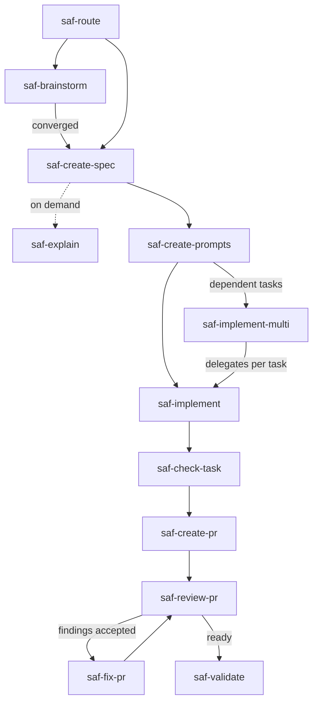

# sdd-agentic-flow

Versão prática em português. Leia o [README principal em inglês](README.md) para a referência técnica completa.

**sdd-agentic-flow** é um **Spec-Driven Agentic Workflow Harness** local-first e zero-dependência para agentes de código.

Seu agente pode entregar um diff e ainda deixar dúvida se cumpriu a intenção. Este toolkit mantém a especificação, a evidência e a revisão humana no mesmo fluxo.

## O que é o sdd-agentic-flow?

**O sdd-agentic-flow é um Agentic Workflow Harness: um plano de controle de engenharia nativo do repositório que transforma desenvolvimento orientado a especificações em workflows limitados e verificáveis para coding agents.**

Não é só um pacote de Agent Skills. As skills são a camada pública de **capacidade**; o host de agentes de código é dono da execução em runtime. Em volta delas: metodologia, contratos de artefato, baselines, modelo de evidência, configuração, CLI e lifecycle.

O objetivo é engenharia assistida por agentes, estruturada, rastreável e verificável. O modo
autonomous assume a entrega local dentro da autoridade delegada; humanos mantêm autoridade nas
fronteiras de segurança, ações externas, irreversíveis e release.

*O agente faz o trabalho. A especificação define o que deve ser verdadeiro. Sensores fornecem
evidência. O modo autonomous resolve o trabalho ordinário e escala apenas na fronteira de autoridade.*

Fontes que informam este desenho — com papéis epistêmicos, não como specs — estão em [inspirations](docs/inspirations.md).

Specs estruturadas, limites claros e governança humana:

- **Camada de capacidade:** skills Markdown com contrato de capacidade sobre baselines TLC e TDD condensados.
- **Dimensionamento adaptativo:** perfis de feature com contexto de projeto auto-descoberto opcional.
- **Zero footprint por padrão:** instalação user-local; `.sdd-agentic-flow/config.yml` só quando você cria.
- **Humano no loop:** o toolkit estrutura o trabalho do agente; você mantém a autoridade final de revisão.
- **Agnóstico de linguagem:** a CLI roda em Node.js >= 22; seu projeto não precisa ser Node.

Para times que usam coding agents, essa divisão mantém o trabalho de engenharia revisável:
humanos definem a intenção e verificam os resultados; agentes executam dentro do harness. O
projeto não afirma ganhos de tokens ou velocidade sem dados medidos.

Instale e rode com `npx sdd-agentic-flow`: [início rápido](#início-rápido), [guia de uso das skills](docs/saf-skills-usage-guide.pt-BR.md), [jornada do desenvolvedor](docs/developer-journey.md) e [arquitetura](docs/architecture.md).

## O problema

Você delega uma tarefa. O agente pula para o código, mistura limites e marca trabalho como concluído sem prova executável. O tempo de revisão vai reconstruir a intenção a partir do diff — não validar o comportamento.

| Falha comum | Resposta local |
| --- | --- |
| Implementação começa antes de entender os requisitos | `saf-create-spec` e `saf-create-prompts` |
| A tarefa é grande demais para uma mudança controlada | `saf-implement` ou `saf-implement-multi` |
| Saída aceita sem evidência | `saf-check-task` e `saf-validate` |
| PR perde rastreabilidade com a feature | `saf-create-pr`, `saf-review-pr` e `saf-fix-pr` |

Veja [por que o toolkit existe](docs/why-this-exists.md). Para o modelo mental do plano de controle, leia [sdd-agentic-flow model](docs/sdd-agentic-flow-model.md) e [engineering model](docs/engineering-model.md).

## Além dos prompts

A maioria das ferramentas para agentes para em prompts melhores. O **sdd-agentic-flow** explicita a fronteira de engenharia:

| Aspecto | Papel em uma linha |
| --- | --- |
| Prompt | Instruções por skill |
| Context | Specs + contexto de projeto + config |
| Harness | Modos, contratos, safety, evidência |
| Execução do host | Loops, sessões e workers escolhidos pelo host |

**SDD** define o que é “pronto” antes da implementação. SAF define restrições e transições admissíveis; o host executa. Evidence Graph é uma projeção de rastreabilidade somente-leitura, não um grafo de execução. Veja o [engineering model](docs/engineering-model.md).

## A solução

Escreva a spec primeiro. A spec é o contrato entre você e o agente: comportamento, escopo e critérios de aceite ficam em `.specs/features/` antes de alterar código de produção.

Você delega um resultado limitado; o toolkit mantém os contratos de workflow e os gates de evidência.
Manual, supervised e autonomous definem quanto da progressão fica com o agente. Cada fase tem uma
skill Markdown, defaults de segurança locais e artefatos de evidência que você inspeciona. Leia a
[metodologia SDD](docs/sdd-methodology.md) (em inglês) para o panorama completo.

## O que muda para você

| Resultado | Como o toolkit entrega |
| --- | --- |
| Limites de tarefa | Specs, prompts de tarefa e `saf-check-task` por fatia |
| Rastreabilidade | Spec → prompt → código → pacote de PR em uma cadeia |
| Evidência antes de concluir | TDD baseline, check reports, validation reports |
| Entrada mais clara para o agente | Specs escritas e `.sdd-agentic-flow/config.yml` em vez de repetir contexto no chat |
| Trabalho assíncrono | Artefatos versionados em `.specs/` e `.sdd-agentic-flow/` |
| Setup reversível | `uninstall --plan`, escopo de instalação explícito, [modelo de confiança](docs/trust-model.md) |

> [!NOTE]
> Benchmark de token economics: planejado para release futura ([ROADMAP.md](ROADMAP.md)). Este README não cita multiplicadores de token ou velocidade sem dados medidos.

## Início rápido

Requer Node.js >= 22 só para a CLI. Seu projeto não precisa ser Node.js. Veja [compatibilidade de ambiente](docs/environment-compatibility.md).

```bash
npx sdd-agentic-flow
```

Esse é o ponto de entrada humano canônico: ele encaminha primeiro uso, setup existente, setup
parcial e recuperação. A CLI recomenda o lifecycle `install` → `init` → `doctor`; configuração
é opcional. Ela é um **plano de controle** para setup, inspeção e manutenção — não invoca skills.
Veja [O que é SDD?](docs/what-is-sdd.md) e a [referência de comandos](docs/commands.md).

Para automação ou uso avançado, use comandos explícitos como `npx sdd-agentic-flow install`,
`npx sdd-agentic-flow init` e `npx sdd-agentic-flow doctor`. A política padrão efetiva é
`apply + supervised`; use `config policy` somente quando um override explícito for necessário.
**Autonomous não significa autoridade ilimitada.** Commit, push, merge, tag, publish, deploy e
outras ações externas ou irreversíveis continuam fora da delegação. A CLI não executa skills.

Depois, invoque `saf-route` ou abra o [guia de uso das skills](docs/saf-skills-usage-guide.pt-BR.md). Copie uma receita de [prompts](docs/prompt-recipes.md) ao delegar a um agente.

Em um terminal real, `npx sdd-agentic-flow` guia a configuração de compartilhamento, hosts de
agentes, workflow, idioma e profundidade do processo (com **Supervisionado** recomendado ao
pressionar Enter). Para automação, use `init` e comandos `config` explícitos. Veja [início rápido](docs/getting-started.md).

Ao escolher `pt-BR`, a saída humana da CLI — prompts, planos, doctor, menu e `learn-sdd` —
passa a usar português brasileiro. Commands, paths, statuses, IDs e JSON permanecem em inglês
canônico para continuar copiáveis e estáveis.

## Como funciona

**Canonical workflow path:** Plan → Prompt → Implement → Check → PR → Review → Fix → Validate



Use `saf-route` quando o próximo passo não estiver claro. Ele recomenda uma skill e aponta para o `SKILL.md` selecionado; não invoca skills nem altera arquivos.

## Exemplos de workflow

Esses walkthroughs ilustram formatos de artefatos e o comportamento esperado da CLI. Não são evidência de execução de agentes. As jornadas executáveis da CLI estão em `scripts/cli-exhaustive.ts` e `scripts/cli-certification.ts`.

| Fluxo | O que ilustra | Walkthrough |
| --- | --- | --- |
| Greenfield | Source item até validação | [task-management](examples/golden/task-management/walkthrough.md) |
| Código existente | Specs a partir de código sem docs | [existing-code mode](examples/golden/existing-code-mode/walkthrough.md) |
| Project context | Ciclo `context refresh` / `context status` | [project-context lifecycle](examples/golden/project-context-lifecycle/walkthrough.md) |
| Loop de PR | Create → review → fix → review | [pr-flow](examples/golden/pr-flow/walkthrough.md) |
| Autonomia AUTO-001 | Idea → spec com config autônoma | [autonomy-idea-to-spec](examples/golden/autonomy-idea-to-spec/walkthrough.md) |
| Autonomia AUTO-002 | Cadeia spec → validate | [autonomy-spec-to-validate](examples/golden/autonomy-spec-to-validate/walkthrough.md) |
| Autonomia AUTO-003 | Guardrail pause → resume | [autonomy-guardrail-pause-resume](examples/golden/autonomy-guardrail-pause-resume/walkthrough.md) |
| Autonomia AUTO-004 | Human override (guardrail 3) | [autonomy-human-override](examples/golden/autonomy-human-override/walkthrough.md) |
| Autonomia AUTO-005 | Budget exhaustion (guardrail 6) | [autonomy-budget-exhaustion](examples/golden/autonomy-budget-exhaustion/walkthrough.md) |

O [exemplo task-management](examples/golden/task-management/) mostra uma feature de ponta a ponta. As fixtures de autonomia ilustram estados de continuidade e reparo; somente checks executados fornecem evidência de um comportamento específico.

## TDD baseline

O toolkit usa um baseline TLC para planejamento e um baseline TDD para implementação. O contrato exigido é evidência comportamental adequada na costura contratual (campo `Public seam`), com resultados atuais gravados. Test-first é recomendado quando afia a spec. O ritual completo RED → GREEN → REFACTOR é opcional e não é prova do harness. Um sensor que passa é evidência, não veredito de correção. Self-report is not evidence. Specs are living control artifacts; rigor follows uncertainty and risk. Detalhe canônico: [TDD baseline](docs/tdd-baseline.md) e [baselines](docs/baselines.md).

## Saiba mais

| Tópico | Doc |
| --- | --- |
| Modelo de engenharia e identidade do produto | [docs/engineering-model.md](docs/engineering-model.md) |
| Jornada ilustrativa do desenvolvedor | [docs/developer-journey.md](docs/developer-journey.md) |
| Metodologia SDD | [docs/sdd-methodology.md](docs/sdd-methodology.md) |
| Arquitetura | [docs/architecture.md](docs/architecture.md) |
| As 12 skills | [docs/skills-catalog.md](docs/skills-catalog.md) |
| Setup por agente | [Codex](docs/using-with-codex.md), [Cursor](docs/using-with-cursor.md), [Claude Code](docs/using-with-claude-code.md), [VS Code + Copilot](docs/using-with-vscode-copilot.md) |
| Política de idioma | [docs/i18n.md](docs/i18n.md) · [README in English](README.md) |
| Contribuir | [CONTRIBUTING.md](CONTRIBUTING.md) |

## Para quem é indicado?

Você se encaixa se adota Spec-Driven Development, entrega em sprint com gates de revisão, fatia specs e tarefas como tech lead, delega fatias rastreáveis a agentes, exige evidência comportamental (TDD e test-first continuam estratégias válidas) ou coordena trabalho multi-agente ou multi-task com controle humano.

## Não é otimizado para

Scripts descartáveis, agentes sem revisão humana, pipelines automáticos de release/deploy, ou fluxos que rejeitam specs, limites de tarefa e checkpoints de validação.

<details>
<summary><strong>Referência técnica</strong> (CLI, bundle oficial, skill map, confiança, segurança)</summary>

## Por que confiar neste toolkit?

- O código, a CLI, os docs, as skills e os checks são open source e inspecionáveis.
- A CLI é pequena, local-first e tem zero dependências npm externas em runtime. As bibliotecas de
  build usadas pela UI rica do terminal são incorporadas ao artefato publicado.
- Não há telemetria, script de postinstall nem acesso de rede da CLI por padrão. O acesso à rede
  se limita a três pontos explícitos: `doctor --check-updates`, `upgrade` (e `--check`/`--plan`) e
  uma pergunta no welcome interativo (TTY human-rich, padrão N). Veja o
  [modelo de confiança](docs/trust-model.md).
- O toolkit não faz commit, push, merge, deploy ou publish automaticamente.
- A instalação é explícita; por padrão (`--scope user`) grava apenas nos diretórios globais de
  skills de cada agente e não cria nenhum arquivo no seu projeto. A configuração é explícita em
  `.sdd-agentic-flow/config.yml`. Veja [escopo de instalação](docs/installation-scope.md).
- `doctor` e `doctor --smoke` validam o setup local, e os arquivos publicáveis são verificados
  contra marcadores de contexto privado.
- Licenciamento e atribuição TLC estão documentados em [NOTICE](NOTICE) e [LICENSING.md](LICENSING.md).
- A revisão humana continua sendo a autoridade final.

Veja o [modelo de confiança](docs/trust-model.md) para escopo e limites.

## Comandos

```text
init [--plan] [--json] [--quiet] [--ascii] [--yes]  Inicializa exatamente o workspace Git atual
config installation [--scope user|project] [--target ...] [--adoption-mode personal|specs-shared|team] [--plan|--yes]  Salva a intenção
context refresh                       Atualiza o contexto do projeto
context [status|refresh|autonomy-state]  Mostra ou atualiza a proveniência do contexto, ou o estado do loop de autonomia
install [--scope user|project] [--target ...] [--plan|--yes] [--quiet]  Instala o bundle oficial
doctor [--json] [--harness] [--smoke] [--contracts] [--autonomy] [--verbose] [--check-updates]  Valida o pacote ou o setup do projeto
upgrade [--check|--plan|--skills-only] Verifica / aplica atualizações da CLI e das skills (com confirmação)
autonomous-resume [--force] [--override-guard=N --reason=...]  Retoma um workflow autônomo pausado num guardrail
uninstall --plan                      Mostra apenas os assets do toolkit que seriam removidos
uninstall --yes [--purge] [--scope user|project|all] [--target ...] [--verbose] [--quiet]  Remove os assets gerenciados
learn-sdd                             Mostra um resumo de SDD em uma tela
version                               Mostra a identidade do pacote
completion bash|zsh|fish              Imprime o completion do shell
help [command]                        Mostra a referência de comandos, ou o uso de um comando
```

`doctor --json` escreve apenas JSON parseável. `doctor --smoke` valida init, install, preservação
e doctor num diretório temporário isolado. `doctor --check-updates` é uma checagem de atualização
diagnóstica; `upgrade --check` é a checagem somente leitura do upgrade; `upgrade` pede confirmação
antes de alterar algo. Um upgrade confirmado executa a versão verificada do pacote e reconcilia
apenas arquivos de skill/shared ausentes ou alterados. Veja o
[modelo de confiança](docs/trust-model.md) e a [política de compatibilidade](docs/compatibility-promise.md).

`install` usa `--scope user` por padrão (grava apenas nos diretórios globais de skills). Passe
`--scope project --adoption-mode team` para instalar em `.agents/skills/` dentro do projeto; o
escopo de projeto exige adoção Team persistida ou explícita. Use `config installation --plan` para
ver os caminhos de destino. Veja [escopo de instalação](docs/installation-scope.md).

Se o `doctor` reportar um `WARN`/`FAIL` que você não entende, veja
[troubleshooting](docs/troubleshooting.md). Todo comando aceita `--help` (equivalente a
`help <command>`) com uso completo e exemplos. Adicione `--quiet` a `init`/`install`/`uninstall`
para suprimir a saída decorativa de sucesso.

Rodar `npx sdd-agentic-flow` sem comando mostra uma tela de status contextual (o que já está
configurado e um próximo comando sugerido) em vez da referência completa. Ela nunca executa nada
sozinha. Num terminal realmente interativo (TTY real e sem a variável `CI`), ela também oferece um
menu numerado abaixo da tela de status; escolher uma entrada executa exatamente o mesmo comando que
a invocação digitada equivalente, e a entrada de uninstall apenas pré-visualiza (`--plan`), nunca
aplica. Saída em pipe, scripts, CI e invocações de agentes veem só a tela de status, sem mudança.
Rode `npx sdd-agentic-flow help` para a referência completa, ou `help <command>` /
`<command> --help` para o uso e os exemplos de um comando.

Comandos e nomes de agente desconhecidos recebem uma sugestão "Did you mean `<closest match>`?"
num bloco estruturado `Try:`. A saída de status colorida (`PASS`/`WARN`/`FAIL`/...) aparece
automaticamente num terminal real; defina `NO_COLOR=1` para forçar texto puro, ou use pipe ou
redirecionamento, que desativam cor automaticamente. Um pipe ou uma execução em CI continuam
gerando texto legível e determinístico; `doctor --json` é o contrato explícito para máquinas.
`FORCE_COLOR` só é respeitado num TTY real; `--ascii` / `SDD_ASCII=1` força símbolos ASCII. Exit
codes: `0` sucesso, `1` falha tratada/de validação, `2` erro inesperado/interno. Veja
[interação da CLI](docs/cli-interaction.md).

O bundle oficial contém 12 skills e a camada shared. Overrides de idioma e de política são
configuração opcional do projeto; use `config policy` quando precisar de um override explícito.
Veja [configuração](docs/configuration.md).

## Modos de execução

O toolkit documenta cinco modos locais de operação: `plan`, `guided`, `apply`, `review` e `full`.
`full` significa um workflow local coordenado, não autonomia irrestrita. Veja
[modos de execução](docs/execution-modes.md).

## Níveis de autonomia

`workflow.autonomy_level` (`manual`/`supervised`/`autonomous`, padrão `supervised`) é um segundo
eixo, ortogonal: `execution_mode` diz o que uma skill pode fazer, e `autonomy_level` diz se ela
precisa de um humano antes da próxima rodar. Configuração ausente resolve para
`apply + supervised`; use `config policy` para um override explícito. Audite com
`doctor --autonomy` e inspecione uma execução em andamento com `context autonomy-state` /
`autonomous-resume`. Veja [níveis de autonomia](docs/autonomy-levels.md) e
[guardrails de autonomia](docs/autonomy-guardrails.md).

## Desinstalação e rollback

```bash
npx sdd-agentic-flow uninstall --plan
npx sdd-agentic-flow uninstall --yes
```

O uninstall remove apenas os assets gerenciados atuais reconhecidos, dos dois escopos por padrão.
Ele preserva specs, código-fonte e caminhos desconhecidos. Use `--scope`/`--target` para escolher
uma instalação. Para resetar o estado de projeto reconhecido, use `uninstall --yes --purge`, que
também remove o estado regenerável do toolkit; `.specs/features` nunca é removido por nenhuma flag.
Adicione `--quiet` para suprimir a linha explicativa final "preserves ...". Use `--purge` para o
reset documentado entre escopos. Veja [desinstalação](docs/uninstall.md) e a
[política de compatibilidade](docs/compatibility-promise.md).

## Mapa de skills

Para a versão longa desta tabela, veja o [catálogo de skills](docs/skills-catalog.md).

| Skill | Propósito | Entrada | Saída | Altera arquivos? | Modo padrão | Recomendado quando |
| --- | --- | --- | --- | --- | --- | --- |
| `saf-route` | Recomendar a próxima skill local | Pedido/artefatos | Recomendação de rota | Não | plan | O próximo passo não está claro |
| `saf-brainstorm` | Dar forma a uma ideia vaga | Ideia bruta | Brief pronto para spec | Sim, quando convergir | guided | A ideia ainda não está pronta para spec |
| `saf-create-spec` | Planejar specs de feature | Item de origem OU codebase existente | Conjunto de specs da feature | Sim, quando autorizado | plan | Requisitos precisam de estrutura, ou código sem documentação precisa de specs |
| `saf-explain` | Explicar uma feature especificada | Pacote de spec | Explicação em linguagem simples | Sim, quando autorizado | guided | Alguém precisa de contexto sem ler todos os artefatos |
| `saf-create-prompts` | Gerar prompts de tarefa | Specs/tarefas | Prompts prontos para agentes | Sim, quando autorizado | plan | O trabalho precisa ser delegado |
| `saf-implement` | Implementar uma tarefa | Tarefa aprovada | Código e evidência | Sim, quando autorizado | apply | Uma tarefa delimitada está pronta |
| `saf-implement-multi` | Planejar execução multi-task | Conjunto de tarefas | Plano de execução | Sim, quando autorizado | guided | As tarefas têm dependências |
| `saf-check-task` | Checagem independente da tarefa | Evidência da tarefa | Check report | Não | review | Antes de aceitar uma tarefa |
| `saf-create-pr` | Preparar PR | Mudança concluída | Pacote de PR | Sim, quando autorizado | guided | É preciso um pacote de revisão |
| `saf-review-pr` | Revisar PR | PR/conjunto de mudanças | Findings | Não | review | Ao revisar uma mudança |
| `saf-fix-pr` | Corrigir findings do PR | Findings | Mudança local corrigida | Sim, quando autorizado | apply | Os findings foram aceitos |
| `saf-validate` | Validar a feature | Evidência da feature | Validation report | Não | review | Antes da conclusão |

## Workflows com agentes

Leia o [guia de uso das skills](docs/saf-skills-usage-guide.pt-BR.md), a
[jornada do desenvolvedor](docs/developer-journey.md), [Codex CLI](docs/using-with-codex.md),
[Cursor](docs/using-with-cursor.md), [Claude Code](docs/using-with-claude-code.md),
[VS Code + GitHub Copilot](docs/using-with-vscode-copilot.md) e as
[receitas de prompt](docs/prompt-recipes.md). Para ferramentas complementares opcionais, veja a
[stack complementar recomendada](docs/recommended-harness.md).

As skills são Markdown-first e instaladas localmente. Veja
[compatibilidade com agentes](docs/agent-compatibility.md) para workflows validados e limites.

## Vocabulário de domínio

Language profiles escolhem o idioma da saída para humanos; um glossário de domínio registra termos
do produto. O glossário é opcional, nunca é criado pelo `init` e só pode ser proposto ou escrito com
autorização explícita. Veja [vocabulário de domínio](docs/domain-vocabulary.md).

## Inspirações e guias

O toolkit adapta os baselines TLC e TDD e combina Spec-Driven Development, skills Markdown-first e
práticas locais de segurança. Essas inspirações agora incluem papéis epistêmicos; os contratos do
projeto continuam sendo a autoridade. Veja [inspirações](docs/inspirations.md), [NOTICE](NOTICE),
[LICENSING.md](LICENSING.md), a [promessa de compatibilidade](docs/compatibility-promise.md) e a
[matriz de compatibilidade](docs/compatibility-matrix.md).

Para apoio a decisões, veja
[escolhendo um feature profile](docs/guides/choosing-a-feature-profile.md),
[adoção num repositório brownfield](docs/guides/adopting-in-a-brownfield-repo.md) e
[TLC/TDD condensado vs. completo](docs/guides/condensed-vs-full-tlc-tdd.md).

## Limites de segurança

A CLI não chama APIs externas, não exige tracker, não sincroniza remotamente nem faz operações de
Git/release por padrão. Os caminhos opcionais de atualização (`doctor --check-updates`, `upgrade`,
pergunta do welcome) nunca alteram nada sem confirmação. Um `upgrade` confirmado usa exatamente a
versão do registry que verificou, atualiza o pacote global só quando a instalação atual é global e
reconcilia apenas arquivos gerenciados de skill/shared ausentes ou alterados. Arquivos locais
divergentes continuam protegidos, a menos que você confirme explicitamente a sobrescrita. Este
toolkit não é garantia de compliance, segurança ou prontidão para produção. Revise as saídas e as
mudanças locais antes de aceitá-las. Veja o [modelo de segurança](docs/safety-model.md).

## Publicação

Maintainers: veja [publicação](docs/publishing.md).

</details>
